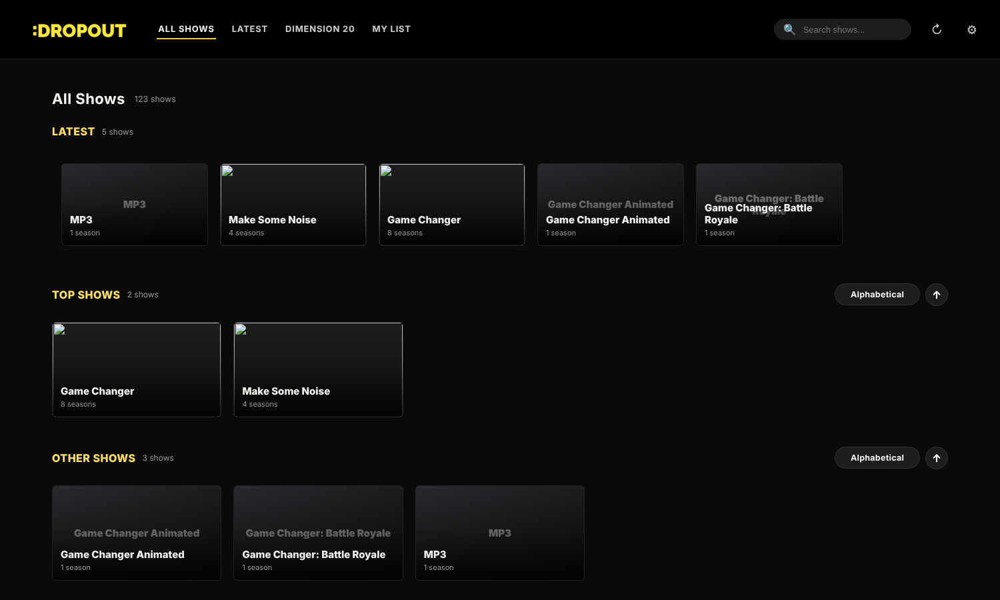

# Dropout YouTube Organised

A single-file, fully client-side browser for [Dropout](https://www.dropout.tv)'s public YouTube playlists. No backend, no build step, no tracking. Bring your own YouTube Data API key.

**Live:** https://dvynsh3.github.io/Dropout-YouTube-Organised

## Features
- All Shows, Latest, Dimension 20 and My List tabs, with sorting
- Favourites and Latest rows with a half-covered "show more" peek card
- "New Show / New Season / New Episode" ribbons, cleared when you open the show
- Season and episode browsing, watched tracking, "mark all previous"
- New shows not in the built-in catalogue are picked up automatically
- **Only on YouTube** section: playlists with no matching Dropout show (including "Free Episodes" ones), grouped into seasons by similar name
- Right-click a card to set a custom cover, move between Top/Other, or hide it (Settings → "Show hidden shows" brings them back)
- Export / Import of all your data; playback links out to YouTube

## Setup
1. In [Google Cloud Console](https://console.cloud.google.com/) create a project, enable **YouTube Data API v3**, and create an **API key**.
2. Open the site and paste the key. It is stored only in your browser's `localStorage`.
3. Restrict the key to the YouTube Data API v3 and to the HTTP referrer `https://dvynsh3.github.io/*`.

## Data and privacy
API key, favourites, watched history, covers and settings live in your browser. The only network calls go to the YouTube Data API and to image hosts for show covers. `localStorage` is per-origin: use **Settings → Export data / Import data** to move between copies.

## Run locally
Open `index.html` in a browser. No build needed.

## Deployment
Pushing to `main` deploys via GitHub Pages (`.github/workflows/pages.yml`). In the repo: Settings → Pages → Source: **GitHub Actions**.

## Credits
Playlist-ID cross-referencing is derived from [soitchu/unofficial-dropout-youtube-browser](https://github.com/soitchu/unofficial-dropout-youtube-browser), GPL-3.0.

## Disclaimer
Unofficial fan project, not affiliated with or endorsed by Dropout. Dropout names, logos and cover art belong to their owners.

## Licence
[GNU GPL v3.0 or later](LICENSE). Copyright (C) 2026 dvynsh3.
