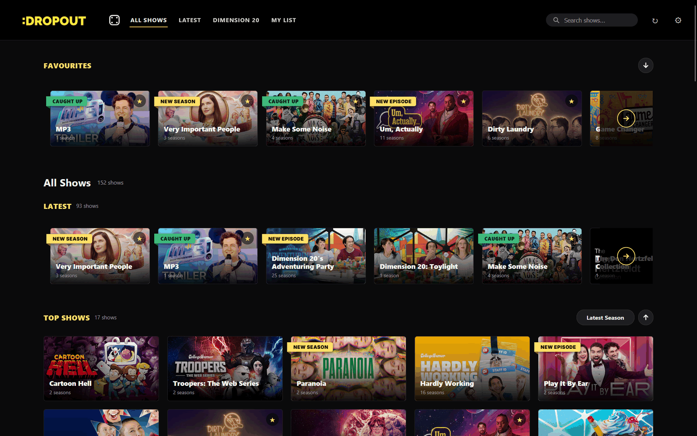
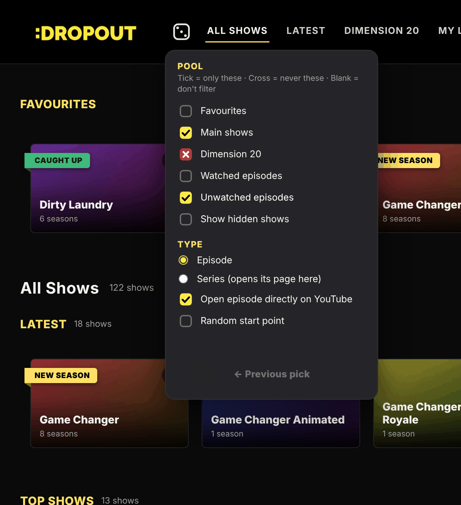
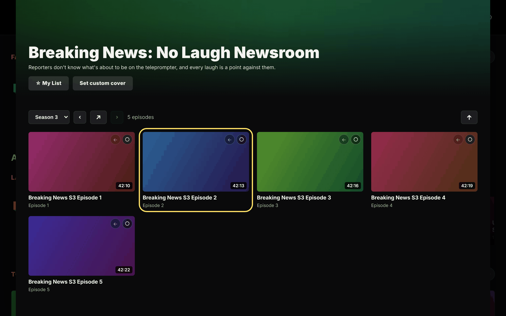

# Dropout YouTube Organised

> Dropout fans who watch through the channel's YouTube membership can browse the playlists by show and season, track what they have watched and pick something at random, without digging through YouTube's flat playlist list.
> 
> Now with the "Random Episode" button, just roll the dice and have an entirely random episode play from your selected pool of series across all the videos on the Dropout YouTube channel.

**Try it:** https://dvynsh3.github.io/Dropout-YouTube-Organised  ·  **Status:** active  ·  **Platform:** browser (desktop-first)

<!-- SCREENSHOT: hero -->

## Why this exists
- **Who:** people who watch Dropout's shows on YouTube through the channel membership.
- **Before:** the shows were a flat list of YouTube playlists that only sort by latest, with no grouping by show, no watched tracking and a playlist search that is not precise and makes mistakes. Getting back to the episode you had left off at took at least 3-4 minutes of manual searching.
- **Now:** every show is a card, each season is one click away, new releases are flagged, and your progress is remembered in your browser.

## What it does
- **Find shows:** browse All Shows, Latest and Dimension 20 tabs; search by name; sort each section on its own.
- **Spot what is new:** see "New Show", "New Season" and "New Episode" ribbons, and a green "Caught up" ribbon on shows you have finished.
- **Keep your place:** mark episodes watched, mark everything up to an episode in one click, and reopen a show at the season you left.
- **Organise:** favourite shows into My List, hide shows you never want to see, move a show between Top and Other, or set your own cover.
- **Decide what to watch:** roll the dice for a random episode, filtered by favourites, Dimension 20, watched or unwatched, with an optional random start point and a Previous button.
- **Reach everything:** see playlists that match no known show under "Only on YouTube", grouped into seasons.
- **Move between devices:** export and import your data as one file.

<!-- SCREENSHOT: key flow (optional, 1 to 3) -->

Screenshots are from the author's own library. The "New Season" and "New Episode" ribbons on some cards were added to the images to show states that were not live when they were taken.

## Quick start
1. Open the [live site](https://dvynsh3.github.io/Dropout-YouTube-Organised).
2. In [Google Cloud Console](https://console.cloud.google.com/apis/library/youtube.googleapis.com), enable **YouTube Data API v3**, then [create an API key](https://console.cloud.google.com/apis/credentials).
3. Paste the key into the setup box and choose **Save & load shows**.
4. Expected result: the show grid fills in with Dropout's playlists matched to shows. Click a show, pick a season, click an episode to watch it on YouTube.

Recommended: restrict the key to the YouTube Data API v3 and to the HTTP referrer `https://dvynsh3.github.io/*`. To run locally, open `index.html` in a browser.

## Decisions and trade-offs
| Decision | Over | Because |
|---|---|---|
| Each user brings their own YouTube API key, kept in the browser | A shared key or a backend | No server to run or pay for, and no key shared between strangers |
| The API key is never exported or hashed | Including it in the export file; hashing it | A hash cannot be sent to YouTube, and exports are files people share |
| Open episodes on YouTube in a new tab | An embedded player | Comments and other adjacent YouTube features would be inaccessible. |
| A built-in show catalogue plus title matching and verified playlist IDs | Matching on titles alone | Titles drift between seasons, which hid seasons until IDs were added |
| One self-contained HTML file | A framework and build step | Easy to host, inspect and fork |

**What I left out on purpose**
- No video hosting or playback inside the app, and nothing that bypasses the membership.
- No accounts or cloud sync: data stays in your browser and moves by export/import.

## Known limits
- You need your own YouTube Data API key. The playlists are public, but the videos in them are members only: without a Dropout channel membership you can browse everything but no video will play.
- The show catalogue is built in. New shows are picked up automatically from "(Full Episodes)" playlists, but names and descriptions for them are basic.
- Playlists named "(Free Episodes)" are ignored for matching because they are incomplete copies, unless they appear under "Only on YouTube".
- Matching is by title, so unusual names can be missed or grouped wrongly.
- Watched state is stored in this app only; it does not change your YouTube history.
- "Caught up" needs each season's episode list to have been loaded at least once.
- Data lives per browser and per address. Moving from a local file to the live site needs export, then import.
- Show covers are loaded from Dropout's image host and may disappear if it changes.

## Privacy and data
- **Stored in your browser (`localStorage`):** API key, favourites, watched episodes, custom covers, sort and hide settings, and cached playlist data (refreshed after six hours).
- **Sent out:** requests to the YouTube Data API using your key, and image requests for show covers. Links open `youtube.com` and `watch.dropout.tv` only when you click them.
- **Never collected:** no analytics, no tracking code and no server run by the author. Nothing is sent to the author.
- **Exports** contain your settings and history but never the API key or cached data.
- The app needs a network connection; it does not work offline.

## Evidence
No usage numbers collected yet.

## Version history
Latest: **v1.0.5** (2026-11-27). Full detail in [CHANGELOG.md](CHANGELOG.md) and [Releases](../../releases).

| Version | Date | What changed for the user |
|---|---|---|
| v1 | 2026-09-26 | First working version: playlists grouped into shows |
| v2 | 2026-09-27 | Real show catalogue and cover art |
| v11 | 2026-10-04 | Right-click menu, Dimension 20 tab, My List sections |
| v16 | 2026-11-21 | Latest row and tab, new-content ribbons |
| v18 | 2026-11-22 | "Only on YouTube" section, hide shows, GPL-3.0 licence |
| v1.0.4 | 2026-11-27 | Random episode button, "Caught up" ribbon, API key left out of exports |

Earlier versions are archived builds restored from local backups, first built 2026-09-26 and uploaded to GitHub on 2026-11-24; the source at each tag is the repository snapshot at upload, not the original code for that version.

## Feedback
Many features here came from community feedback, and more is welcome. Please open an [Issue](../../issues). Useful details: your browser, what you clicked, what you expected, and the show name if a show or season is missing or mismatched. Do not paste your API key.

## How this was built
I owned the problem, scope, trade-offs and testing: I specified each feature, directed the work, tested it against my own library and decided what shipped. Claude (Anthropic) was the only AI used and wrote much of the implementation. Many of the features were added in response to feedback from the community.

## Credits
Playlist-ID cross-referencing is derived from [soitchu/unofficial-dropout-youtube-browser](https://github.com/soitchu/unofficial-dropout-youtube-browser) (GPL-3.0).
Unofficial fan project, not affiliated with or endorsed by Dropout. Dropout names, logos and cover art belong to their owners.

## Licence
[GNU GPL v3.0 or later](LICENSE). Copyright (C) 2026 dvynsh3.
